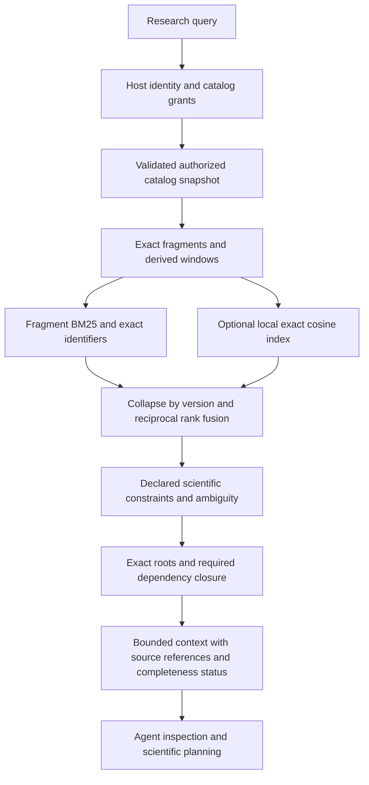

# Hybrid Scientific Retrieval v1

EigenGrid discovers versioned scientific guidance through `ScientificRetrievalService`.
The default is lexical retrieval. Hybrid retrieval is an explicit local configuration;
shipping this implementation does not qualify its ranking as scientifically reliable.
The [exploratory evaluation](evaluations/retrieval-v1.md) records measured results and
remaining activation gates.

The canonical protocols, exact versions and content hashes remain the source of truth.
A vector index can be deleted or rebuilt without changing a protocol, compiled mission,
approval, execution interface or previously persisted graph. Retrieval never promotes a
skill or grants execution permission.

## Data flow and responsibilities



| Module                 | Responsibility                                                                       |
| ---------------------- | ------------------------------------------------------------------------------------ |
| `catalog.ts`           | Host authorization, canonical loading, byte-based invalidation, immutable skill data |
| `documents.ts`         | Fragment windows, exact source identities, scientific and access metadata            |
| `ranking.ts`           | BM25, protocol-level RRF, explicit compatibility assessment                          |
| `vector-index.ts`      | Local SQLite index, integrity checks, transactional replacement, exact cosine        |
| `embedding-process.ts` | Bounded local JSONL embedding port, serialization and timeouts                       |
| `service.ts`           | Search orchestration, audit identity, reauthorization and fallback                   |
| `context.ts`           | Required dependency closure and explicit context completeness                        |
| `installed.ts`         | Single-user CLI/TUI configuration and local model manifest                           |
| `evaluation.ts`        | Relevance, dependency, omission, latency and context-size measurements               |

These files are in `packages/scientific-retrieval/src`. The optional Python worker is
`python/src/eigengrid_retrieval`. It uses CPU inference in a separate process; workers
and Slurm allocations are not involved.

## Canonical identities and derived documents

Existing `SkillVersionReference` and `SkillFragmentReference` contracts are unchanged.
A fragment identifies its skill ID, exact version, skill content digest, fragment ID,
fragment SHA-256, relative source path and selector. Markdown fragments use headings;
structured assets retain the existing whole-file selector. Evaluations and helper scripts
are excluded from retrieval. Canonical files are never rewritten to accommodate embeddings.

A derived document adds catalog ID, access scope, asset kind, domains, declared engines,
review status and a 1,200-character window with 160-character target overlap, preserving Unicode symbols. Window offsets are
UTF-16 character offsets into the parent fragment. The window ID hashes the exact parent
reference, offsets and document policy. Its content hash covers the embedding input,
including skill ID, title, kind and selector. Context returns full canonical fragments,
not truncated windows labeled with a full-fragment hash.

Scientific roles use existing asset kinds: `summary`, `protocols`, `decision_rules`,
`diagnostics`, `validation`, `references`, `concepts` and `engine_mappings`. A model can
retrieve conceptual or diagnostic content without embedding an entire module as one vector.
The model's tokenizer can still truncate a long metadata-prefixed window at its pinned
512-token limit. Windowing is a versioned engineering policy, not a scientific segmentation
claim; changing it invalidates the index.

The index persists the authorized corpus digest, scope digest, document policy, embedding
identity and each document's metadata/vector. The embedding identity includes model name,
immutable revision, dimensions and a digest of the weights/tokenizer hashes, pooling,
prefixes, token limit and runtime versions. It contains no canonical source text.

## Ranking and applicability

The modes are:

- `lexical`: fragment BM25 with exact skill ID/version preference; no embedding process.
- `vector`: exact cosine comparison, mainly for evaluation; no lexical fusion.
- `hybrid`: union of lexical and vector candidates followed by RRF.
- `scientific`: hybrid retrieval plus declared constraints and dependency-aware context.

Each candidate list is collapsed to one entry per exact skill version before RRF. This
prevents a long protocol from casting many votes. RRF uses `sum(1 / (k + rank))`, with
one-based ranks and configurable `k`, initially 60. BM25 uses `k1=1.2`, `b=0.75` and the
existing English/Spanish scientific normalization. These are unqualified starting values.
Unknown or unauthorized semantic IDs can never create a canonical result. The legacy
`searchScientificSkills` API now unions canonical semantic candidates with lexical hits
instead of excluding semantic-only matches.

Reranking reports `incompatible`, `unknown` or `constraints_matched`. It checks declared
engine versions, minimum knowledge maturity, requested capability, supplied input names,
review state/expiry and conditional-conflict uncertainty. Domain filters apply to roots;
dependencies may legitimately cross domains. Resolver conflicts and version constraints
apply when composing the selected graph. A high similarity cannot override a failed
constraint. Exact ID lookup still returns the requested entry for inspection, with its
incompatibility reported; context refuses to apply that entry.

Inputs are names of available scientific inputs, not a proof that those inputs are correct.
No automatic extractor infers charge, spin, topology, current installation state or Slurm
allocation from a sentence. Such constraints must be supplied explicitly by the host and
are still verified by the scientific/execution layers. Unknown facts remain unknown.

Scores are not calibrated probabilities. Automatic memory selection requires an exact ID
or the leading lexical candidate with a raw BM25 margin of at least 20%. Semantic-only or
otherwise ambiguous candidates remain inspectable; they are not silently chosen. The
agent receives up to three pinned candidates and is directed to inspect them. This margin
is an engineering heuristic, not scientific confidence. Model-specific calibration and
agent-decision evaluation remain required before changing the default.

## Context and dependency guarantees

`service.context(result, request, options)` checks the search audit digest, request,
current corpus and authorization view. Roots can be explicitly supplied as exact version
references. Otherwise it uses the leading compatible result only when unambiguous.
It invokes the existing deterministic resolver with exact root versions and follows all
mandatory dependencies, independently of their similarity scores. Recommendations are
not automatically imposed. Conditional conflicts use supplied conditions; unspecified
conditions remain a reason for uncertainty.

The conservative required set contains a summary for every resolved module and all
procedure, decision, diagnostic and validation fragments in the closure. Optional source
and concept fragments fill the remaining budget. This is deliberately broader than a
future scientifically curated minimal set. It does not assert that the corpus itself
contains every warning a scientist needs.

| Context status        | Meaning                                                                                         |
| --------------------- | ----------------------------------------------------------------------------------------------- |
| `complete`            | All fragments required by this retrieval policy fit; no scientific approval implied             |
| `budget_insufficient` | Required fragments were omitted; their authorized IDs and required character count are explicit |
| `ambiguous`           | Inspect candidates or provide exact selected roots; no procedure was silently selected          |
| `unavailable`         | Canonical roots, constraints, closure or required fragments could not be satisfied              |
| `empty`               | No eligible roots                                                                               |

Limits apply even to required fragments. Context never overflows a budget to hide an
omission, and never truncates a scientific fragment under its original SHA-256. The
selection digest covers search identity, corpus/scope, graph identity, selected references,
required IDs, policy, status and budgets. Returned content characters are bounded;
JSON metadata and citation wrappers consume additional tokens. Token counts in the
benchmark are estimates (`characters / 4`), not an LLM tokenizer measurement.

`list-protocols` and `inspect-protocol` keep their existing public input/output schemas.
Inspection now reads the validated snapshot, and stale corpus-pinned pagination is
rejected after same-path content changes. The CLI/TUI agent uses this service instead of
directly taking the first lexical match. Existing mission compilation with explicit
protocol selections and persisted mission evidence is unchanged.

## Authorization, persistence and failure behavior

A multi-user host constructs `AuthorizedScientificCatalog` with a callback returning its
current principal and catalog grants. A grant is public, private to an owner, or bound to
a project, and carries a policy revision. Denied catalogs are excluded before filesystem
access, fragment loading, counts, lexical statistics, embeddings and vector comparison.
There is no query parameter that can grant access. Duplicate identities across authorized
catalogs fail rather than choosing an arbitrary source.

Every cache lookup fingerprints actual file bytes, so same-size or restored-mtime edits
invalidate the snapshot. Initial loading checks that the authorized catalog stayed stable
while fragments were materialized. Canonical validation failure fails closed. No stale
canonical snapshot is used as a fallback.

Index files are scoped to actor, project memberships, visible grants, grant revisions and
catalog paths. The host callback runs again after asynchronous query embeddings and
between rebuild batches. Revocation discards a pending result or aborts the rebuild.
Restricted dependency-resolution failures return a generic diagnostic, not hidden IDs.
A retained old index is not reusable by a newly restricted view. Administrators remain
responsible for deleting retired files/backups according to retention policy.

SQLite files use mode 0600 and newly created index directories use 0700. Rebuild writes
a temporary complete generation, closes it and atomically renames it. Failed rebuilds
preserve the previous complete file. Readers validate schema, checksum, all canonical
metadata, row count, finite dimensions and unit-vector norms. Local payloads are limited to 120 MiB (128 MiB including the SQLite file). The digest is an integrity
check, not a signature against a compromised OS account. Host grants, roots and embedding
configuration must come from trusted application configuration.

| Failure                                                      | Result                                                                     |
| ------------------------------------------------------------ | -------------------------------------------------------------------------- |
| No provider configured                                       | Lexical retrieval                                                          |
| Index absent, stale or corrupt                               | Lexical fallback with explicit `indexState`; rebuild is an operator action |
| Embedding timeout, process error or malformed response       | Lexical fallback; bounded process cleanup                                  |
| Content, access policy or model identity changes during work | Abort; retry with the current view                                         |
| Invalid canonical catalog                                    | Fail closed; never substitute the vector index                             |
| Unresolvable dependency graph                                | No assembled scientific procedure; generic diagnostic                      |

The local adapter assumes one trusted OS user and an installed/explicit catalog root.
Do not reuse its process-global cache as a web/server tenant boundary. Server integrations
must inject a host-bound service, including into `AgentMemory.scientificRetrieval`.
Local observations and experiential lessons keep their separate storage and authority.
Historical documentation about an engine cannot establish its current presence on a node.

A host integration can supply its authorization snapshot without exposing it to the model:

```ts
const catalog = new AuthorizedScientificCatalog(() => ({
  principal: trustedSessionPrincipal(),
  catalogs: trustedCurrentCatalogGrants(),
}));
const retrieval = new ScientificRetrievalService({
  catalog,
  embeddings,
  index,
  mode: "scientific",
});
const request = { query, engine: { id: "orca", version: "6.1.0" } };
const result = await retrieval.search(request);
// Select only after inspecting candidates and their scientific constraints.
const context = retrieval.context(result, request, { roots: selectedExactReferences });
```

The `trusted...` functions belong to the embedding host application's authentication and
authorization layer. `selectedExactReferences` contains complete skill version references,
not IDs invented by the model. Calling this API does not submit a job or approve a plan.

## Local operation

Lexical mode requires no new runtime dependencies:

```bash
eigengrid retrieval status
eigengrid retrieval search --query 'workflows.geometry-optimization' --context
eigengrid retrieval search --query 'corrientes anulares en caminos opuestos' --k 5
```

For optional embeddings, create a separate Python 3.13 environment. The provided hash lock
is qualified for Linux x86_64/CPython 3.13 only. It is separate from the release's normal
Python dependency lock; neither model weights nor ONNX Runtime are bundled by default.
The native distribution includes example manifests, the optional lock and evaluation cases
under `share/eigengrid/retrieval`, plus the worker module in the Python wheel.
For a standalone archive, use the lock, model/config examples and `evaluation-cases.jsonl`
from that directory; use the wheel from the archive's `python/` directory. Source paths
in the following commands are for development checkouts.

From a source checkout, using the wheel from a native build:

```bash
python3.13 -m venv /absolute/path/to/embedding-venv
/absolute/path/to/embedding-venv/bin/pip install --require-hashes \
  -r python/requirements-retrieval-linux-x64-py313.lock
/absolute/path/to/embedding-venv/bin/pip install --no-deps dist/native/python/*.whl
mkdir -p /absolute/path/to/retrieval
cp examples/retrieval/multilingual-e5-small.json /absolute/path/to/retrieval/
/absolute/path/to/embedding-venv/bin/python -m eigengrid_retrieval.prepare \
  /absolute/path/to/retrieval/multilingual-e5-small.json --download
```

Provisioning downloads only the two pinned example artifacts and verifies their hashes.
Omit `--download` to verify files supplied offline. Retrieval itself never downloads files
or calls an external embedding API. For source development, the same worker can be made
available with `PYTHONPATH="$PWD/python/src"` instead of installing a wheel.

Copy `examples/retrieval/config.json` to that directory, set its absolute Python executable
and keep the relative manifest path. Protect the configuration against writes by others:

```bash
chmod 600 /absolute/path/to/retrieval/config.json
export EIGENGRID_RETRIEVAL_CONFIG=/absolute/path/to/retrieval/config.json
eigengrid retrieval rebuild
eigengrid retrieval status
eigengrid retrieval search --query 'How do opposing loop currents cancel?' --context
```

`scientific` mode enables the optional pipeline for that process. Remove the environment
variable or set `mode` to `lexical` to return to the default. Relative manifest/index paths
are resolved against the config file. `--config` explicitly selects configuration for the
manual retrieval command. Agent tools cannot set this path, spawn arbitrary configured
commands or rebuild an index.

The worker is a persistent, serialized JSONL process with a 60-second request deadline,
bounded requests/responses and an idle shutdown. It uses only `CPUExecutionProvider`,
attention-mask mean pooling and L2 normalization. Its runtime versions must match the
manifest. This example uses multilingual E5 query/passage prefixes and 384 dimensions.
Changing weights, tokenizer, prefixes, dimensions, pooling, token limits or runtime
versions requires a new configuration identity and index rebuild. Moving the corpus
changes the scope identity and also requires rebuilding that local view.

## Evaluation and rollout

```bash
PYTHONPATH="$PWD/python/src" bun apps/cli/bin/eigengrid.ts retrieval evaluate \
  --config /absolute/path/to/retrieval/config.json \
  --cases packages/scientific-retrieval/evals/retrieval-v1.jsonl \
  --k 5 --repeats 3 > retrieval-report.json
```

The evaluator compares the previous skill-level lexical search, new fragment BM25,
vector-only retrieval, hybrid RRF and scientific reranking/context. It records Recall@k,
graded nDCG@k, exact lookup success, a top-ranked selection-error proxy, explicitly
excluded hits, dependency coverage, critical omissions, p50/p95 latency and estimated
context tokens. Context metrics apply only to the graph/context configuration; other
modes have not assembled a context. Fallback counts prevent missing vectors from being
presented as a successful hybrid evaluation.

The checked-in English/Spanish labels are exploratory engineering judgments based on the
public catalog, not an independently reviewed scientific gold set. AMBER and live-cluster
queries are negative controls because that installed corpus cannot answer them. The
selection-error proxy counts a nonrelevant or explicitly incompatible first result, and
any result for a required-abstention case. It is stricter than the agent's actual behavior:
ambiguous candidates are not automatically selected. It does not measure LLM scientific
reasoning, tool choice or downstream outcomes.

Activation requires exact lookup non-regression, actual vectors, improved selection
quality, complete required dependency coverage and no critical omissions, followed by
independent label review and agent-decision evaluation. The evaluator always reports
`enableHybridByDefault: false`; a benchmark cannot change application policy.

| Phase | Implemented boundary                                                                                       |
| ----- | ---------------------------------------------------------------------------------------------------------- |
| P0    | Fragment/source identities, access scopes, invalidation and corruption/revocation regressions              |
| P1    | Optional local CPU adapter, persistent rebuildable exact vectors, union/RRF, lexical fallback              |
| P2    | Existing hard-dependency resolver, explicit constraints, conservative bounded context                      |
| P3    | Reproducible exploratory benchmark; independent scientific labels and agent-decision qualification pending |
| P4    | Deferred: pgvector, ANN/HNSW, incremental indexing, tenant-aware server integration and specialized models |

The current public corpus has 31 modules, not over 100. The exact-index design supports
larger local catalogs, but this report does not qualify latency or retrieval quality for
an unseen installation with hundreds of modules. No deployment to a named cluster is
performed by these changes.

## Technical sources

- [Cormack, Clarke and Büttcher, SIGIR 2009](https://plg.uwaterloo.ca/~gvcormac/cormacksigir09-rrf.pdf): RRF formula and original empirical parameter choice; no universal scientific calibration is implied.
- [Multilingual E5 model card](https://huggingface.co/intfloat/multilingual-e5-small): model dimensions, prefixes, pooling and token limit.
- [Pinned ONNX conversion](https://huggingface.co/Xenova/multilingual-e5-small/tree/761b726dd34fb83930e26aab4e9ac3899aa1fa78): optional example model artifacts.
- [ONNX Runtime Python API](https://onnxruntime.ai/docs/api/python/api_summary.html): explicit CPU execution provider and inference sessions.
